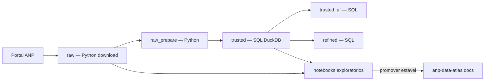
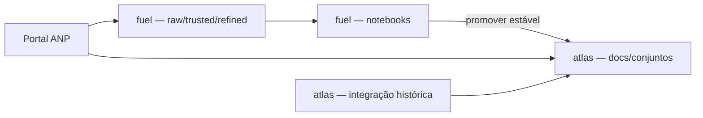

# anp-fuel-analytics

Monorepo de **análises exploratórias** sobre dados abertos de combustíveis da ANP. Aqui testamos hipóteses, perfilamos colunas e validamos qualidade — o que for estável e útil para outros projetos **volta documentado** no [anp-data-atlas](https://github.com/GabrielTrentino/anp-data-atlas).

## Objetivo

Executar estudos reproduzíveis (notebooks + pipelines) que respondem: *como são os dados na prática?* — antes de construir integração histórica ou produtos analíticos.

| Este repositório (`anp-fuel-analytics`) | [anp-data-atlas](https://github.com/GabrielTrentino/anp-data-atlas) |
|----------------------------------------|---------------------------------------------------------------------|
| **Exploração** — perfil, categorias, duplicatas, séries piloto | **Referência** — catálogo, metadados, dicionário, matriz de arquivos |
| Notebooks e pipelines de transformação | **Integração histórica** — pipeline que consolida a série no tempo |
| Descobertas alimentam o atlas (seções novas no `.md`) | Documentação permanente para quem for integrar ou analisar |

Dados em `data/` são **locais e não versionados**. Versionamos código, notebooks, SQL e READMEs dos estudos.

## O que cada repositório guarda

| Conteúdo | **anp-fuel-analytics** (este repo) | **[anp-data-atlas](https://github.com/GabrielTrentino/anp-data-atlas)** |
|----------|-----------------------------------|--------------------------------------------------------------------------|
| Metadados oficiais ANP | Link para o atlas | Sim — `docs/conjuntos/` |
| Matriz de URLs e lacunas do portal | Referência ao atlas | Sim |
| Inventário empírico dos brutos (linhas, m³, `Data` por arquivo) | Notebooks (ex.: `01_perfil_exploratorio`) | Promovido quando estável |
| Schema confirmado na prática | Tabelas e código nos notebooks | Resumo em Markdown |
| Chave candidata, regras de agregação | Validação exploratória | Documentação de integração |
| Anomalias em investigação | `TODO.md` do estudo | Achados confirmados |
| Gráficos, `describe()`, experimentos | Sim | Não |
| Camadas raw / trusted / refined | Sim — `pipelines/` | Não |
| Pipelines de integração histórica | Protótipos por estudo | Série consolidada documentada |

**Fluxo:** explorar aqui → promover findings estáveis para `docs/conjuntos/{slug}.md` no atlas. O atlas é o manual de integração; este repo é o laboratório que o alimenta.

## Fluxo de processamento

Pipeline local por estudo (ex.: tancagem), orquestrado por [`config/monorepo.yaml`](config/monorepo.yaml) e `pipelines/run.py`:



| Etapa | Engine | Entrada | Saída |
|-------|--------|---------|-------|
| `raw` | Python | URLs ANP | `data/raw/{slug}/` |
| `raw_prepare` | Python | XLSX legados (ex. out/2022) | CSV em `data/raw/` |
| `trusted` | SQL | `data/raw/**/*.csv` | `data/trusted/{slug}/tancagem.parquet` |
| `trusted_uf` | SQL | trusted | `data/trusted/{slug}/uf/{UF}.parquet` |
| `refined` | SQL | trusted | `data/refined/{slug}/*.parquet` |

```bash
py pipelines/run.py --list                              # estudos e etapas
py pipelines/run.py tancagem-abastecimento              # todas as etapas + testes de qualidade
py pipelines/run.py tancagem-abastecimento trusted      # uma etapa
py pipelines/run.py pmqc check                          # só os testes de qualidade
py pipelines/run.py all --skip-raw                      # todos os estudos, sem baixar de novo
py pipelines/run.py catalog                             # recria data/anp.duckdb (uma view por tabela)
```

**RAW** permanece em Python. Estudos simples declaram os arquivos no bloco `download` do [`config/monorepo.yaml`](config/monorepo.yaml) e usam o downloader comum (`pipelines/core/download.py`: retry, escrita atômica e manifesto `data/raw/{slug}/_manifest.json` com URL, tamanho, sha256 e data). Estudos com regras próprias de nomes (PMQC, série histórica de preços, produção por poço) têm script em `pipelines/python/`, que monta a lista e chama o mesmo downloader. Todos aceitam `--force` (rebaixar) e `--check` (só testar as URLs).

**TRUSTED** e **REFINED** usam arquivos `.sql` em `pipelines/sql/{slug}/`, executados via DuckDB com variáveis `{{RAW_DIR}}`, `{{TRUSTED_PARQUET}}` etc. Cada etapa SQL declara `outputs` no YAML; o `run.py` falha se uma saída declarada não for gerada, e variáveis extras vêm de `vars` na etapa.

### Testes de qualidade

O bloco `quality` de cada estudo declara regras sobre as tabelas geradas (`min_rows`, `not_null`, `unique`, `no_duplicate_rows`, `accepted_values`, `range`). Elas rodam ao fim de `run.py <slug>` (ou com `run.py <slug> check`) e gravam `data/quality/{slug}.json`. Regras com `severity: warn` registram anomalias conhecidas da fonte sem falhar o pipeline; as demais falham.

### Ver as linhas

`py pipelines/run.py catalog` cria `data/anp.duckdb` com uma view por saída (schema = estudo, ex.: `pmqc.trusted_pmqc`) e `meta.quality` com o resultado dos testes. Abra com `duckdb -ui data/anp.duckdb` (navegador de tabelas no browser), DBeaver ou Power BI.

### CI

- [`ci.yml`](.github/workflows/ci.yml): a cada push/PR roda `ruff` e `pytest` (Ubuntu e Windows). Os testes validam o YAML contra scripts e SQL, executam SQLs trusted com fixtures pequenas em `tests/fixtures/` e cobrem download e regras de qualidade.
- [`portal.yml`](.github/workflows/portal.yml): toda segunda verifica se as URLs do portal ainda respondem.

Para rodar localmente: `pip install -r requirements-dev.txt`, depois `ruff check .` e `pytest`.

## O que promover para o atlas (e o que não)

### Promover (sim)

| Tipo | Exemplo | Destino no atlas |
|------|---------|------------------|
| Inventário por arquivo | linhas e m³ por `2025/janeiro.csv` | Inventário empírico |
| Chave sem duplicatas | `Data` + `CodInstalacao` + `Tag` + `GrupoDeProdutos` | Qualidade e chaves |
| Tipos reais observados | `Cnpj` como string, não float | Estrutura dos arquivos |
| Domínios categóricos | 11 `Segmento`, 4 `GrupoDeProdutos` | Estrutura / qualidade |
| Anomalia documentada | nov/dez 2022 −44% m³ vs jun–out | Anomalias conhecidas |
| Regra de soma | agregar `TancagemM3` na granularidade da chave | Qualidade e chaves |

### Não promover (manter aqui)

| Tipo | Exemplo | Onde ficar |
|------|---------|------------|
| Notebook completo | `01_perfil_exploratorio.ipynb` | `estudos/{slug}/notebooks/` |
| Gráficos e rankings | evolução GO vs SP | Notebook |
| TODO / hipótese | escopo `tancagem_terminais_*` em 2022 | `estudos/{slug}/TODO.md` |
| SQL e orquestrador | `trusted.sql`, `run.py` | `pipelines/` |
| Parquets locais | `tancagem.parquet` | `data/` (gitignored) |

### Critérios (checklist)

Antes de editar o atlas, confira:

1. **Reproduzível** — resultado verificável nos CSVs brutos ou no trusted.
2. **Útil para integração** — ETL, chaves, lacunas, armadilhas de nomenclatura.
3. **Estável** — revisado; não é rascunho de célula em andamento.
4. **Referenciável** — cite notebook (`01_perfil…`), arquivo fonte e data do snapshot.

Se ainda estiver em investigação, use `TODO.md` e promova só quando fechar.

## Estudos

Prioridade e status: [TODO.md](TODO.md). Documentação de referência no [anp-data-atlas](https://github.com/GabrielTrentino/anp-data-atlas/tree/main/docs/conjuntos).

| Estudo | Slug | Status |
|--------|------|--------|
| Tancagem do Abastecimento Nacional | [tancagem-abastecimento](estudos/tancagem-abastecimento/) | pipeline ◐ |
| Movimentação de derivados | [movimentacao-derivados](estudos/movimentacao-derivados/) | planejado |
| Cadastro revendas combustíveis | [cadastro-revendas-combustiveis](estudos/cadastro-revendas-combustiveis/) | planejado |
| Cadastro revendas GLP | [cadastro-revendas-glp](estudos/cadastro-revendas-glp/) | planejado |
| Pontos de abastecimento | [pontos-abastecimento](estudos/pontos-abastecimento/) | planejado |
| Distribuidores combustíveis líquidos | [distribuidores-combustiveis-liquidos](estudos/distribuidores-combustiveis-liquidos/) | planejado |
| PMQC | [pmqc](estudos/pmqc/) | planejado |
| PML | [pml](estudos/pml/) | planejado |
| Série histórica de preços | [serie-historica-precos](estudos/serie-historica-precos/) | planejado |
| Vendas de derivados | [vendas-derivados](estudos/vendas-derivados/) | planejado |
| Fiscalização do abastecimento | [fiscalizacao-abastecimento](estudos/fiscalizacao-abastecimento/) | planejado |
| Capacidade terminais | [capacidade-armazenagem-terminais](estudos/capacidade-armazenagem-terminais/) | planejado |
| Movimentação terminais aquaviários | [movimentacao-terminais-aquaviarios](estudos/movimentacao-terminais-aquaviarios/) | planejado |
| Registro lubrificantes | [registro-lubrificantes](estudos/registro-lubrificantes/) | planejado |
| Processamento e derivados | [processamento-petroleo-derivados](estudos/processamento-petroleo-derivados/) | planejado |
| Produção biocombustíveis | [producao-biocombustiveis](estudos/producao-biocombustiveis/) | planejado |
| Produção por estado | [producao-por-estado](estudos/producao-por-estado/) | planejado |
| Produção por poço | [producao-por-poco](estudos/producao-por-poco/) | planejado |
| Importações e exportações | [importacoes-exportacoes](estudos/importacoes-exportacoes/) | planejado |
| Anuário estatístico | [anuario-estatistico](estudos/anuario-estatistico/) | planejado |

Configuração compartilhada entre estudos: [`config/monorepo.yaml`](config/monorepo.yaml).

## Estrutura

```
anp-fuel-analytics/
├── config/
│   └── monorepo.yaml              # estudos, caminhos e etapas do pipeline
├── pipelines/
│   ├── run.py                     # orquestrador: py pipelines/run.py <slug> [step]
│   ├── core/                      # config, download, executor SQL, qualidade, catálogo
│   ├── python/                    # RAW: download genérico + scripts com regras próprias, prepare
│   └── sql/{slug}/                # etapas TRUSTED e REFINED
├── data/                          # local — não versionado
│   ├── raw/{slug}/
│   ├── trusted/{slug}/
│   └── refined/{slug}/
├── estudos/{slug}/
│   ├── README.md
│   └── notebooks/
├── tests/                         # pytest + fixtures pequenas no formato da ANP
├── requirements.txt
└── README.md
```

## Ambiente

```bash
py -3 -m venv .venv
.venv\Scripts\activate
pip install -r requirements-dev.txt   # inclui pytest e ruff
jupyter lab
```

## Pipeline (ex.: tancagem)

Detalhes das etapas na seção [Fluxo de processamento](#fluxo-de-processamento) acima.

| Etapa | Engine | Saída principal |
|-------|--------|-----------------|
| `raw` | Python | `data/raw/tancagem-abastecimento/` |
| `raw_prepare` | Python | CSV derivados (ex.: out/2022 XLSX) |
| `trusted` | SQL | `data/trusted/.../tancagem.parquet` |
| `trusted_uf` | SQL | `data/trusted/.../uf/{GO,TO,DF}.parquet` |
| `refined` | SQL | `data/refined/.../tancagem_por_mes_uf_grupo_tag.parquet` |

## Fluxo com o atlas

Complemento ao [fluxo de processamento](#fluxo-de-processamento) local — relação entre os dois repositórios:



O atlas documenta **o quê** integrar; o fuel-analytics prova **como** e gera camadas locais para análise.

## Licença

[MIT](LICENSE) — código. Dados ANP: termos da agência.

https://github.com/GabrielTrentino/anp-fuel-analytics
